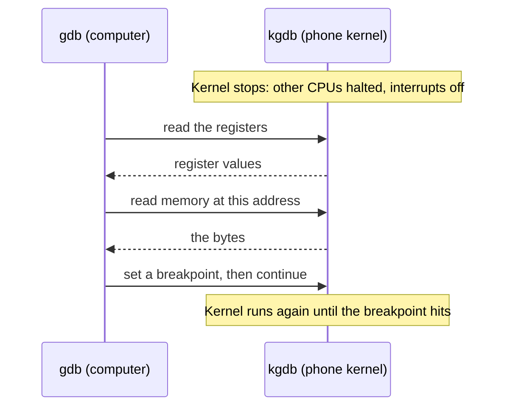
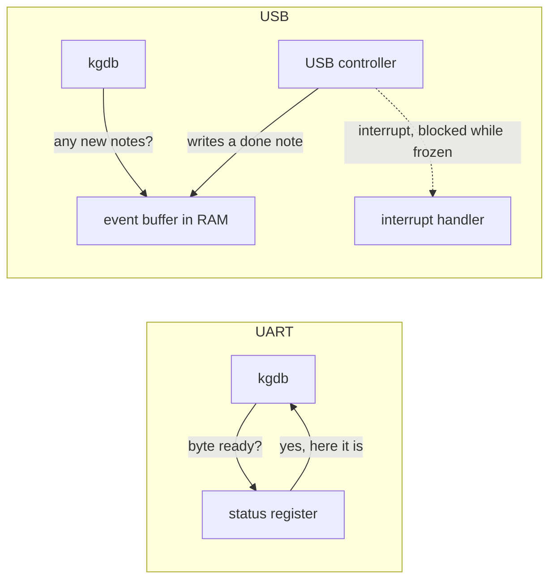
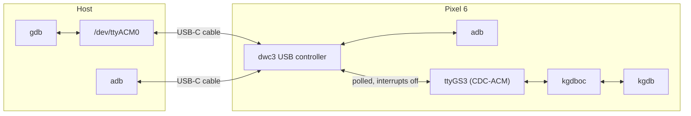
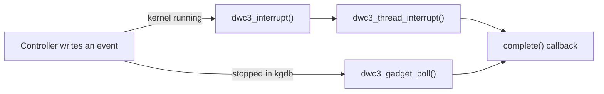
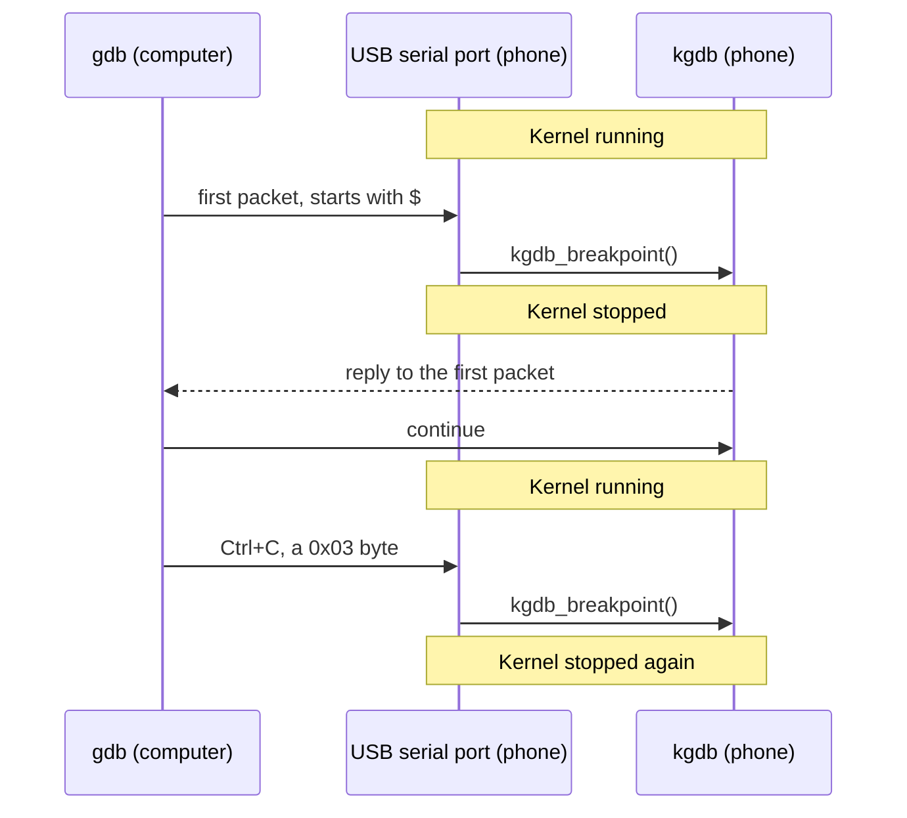

This post explains how to debug the Android kernel on a Pixel with gdb, over the same USB-C cable that carries adb, with no UART adapter, debug board or other extra hardware.

All the code and patches are in [pixel6-kgdb-usb](https://github.com/d0mzw/pixel6-kgdb-usb). The README takes you from a stock phone to a gdb session step by step: build the patched kernel, flash it, and attach. Each patch has a document in [`docs/`](https://github.com/d0mzw/pixel6-kgdb-usb/tree/main/docs) explaining how it works, so this post sticks to the big picture.

| Setup    | Details                                                           |
| -------- | ----------------------------------------------------------------- |
| Phone    | Pixel 6 (`oriole`), Google Tensor (gs101), bootloader unlocked    |
| Platform | Android 16, build `CP1A.260405.005`                               |
| Kernel   | `6.1.124-android14-11`, branch `android-gs-raviole-6.1-android16` |

## Overview

I need an Android kernel debugging environment to study some exploit primitives on a real device. Most published kgdb setups for Android reach the kernel over a UART, a hardware serial port. On recent Pixel devices that means a debug board on the USB-C sideband pins, as in Andrey Konovalov's [Debugging the Pixel 8 Kernel via KGDB](https://xairy.io/articles/pixel-kgdb); on older Nexus phones it was a cable wired into the headphone jack, as in Joshua Drake and Ryan Smith's [Building a Nexus 4 UART Debug Cable](https://www.optiv.com/blog/building-nexus-4-uart-debug-cable). The one USB-only precedent is Trend Micro's [Practical Android Debugging via KGDB](https://www.trendmicro.com/en/research/17/a/practical-android-debugging-via-kgdb.html) from 2017, which polled the dwc3 USB controller on a Nexus 6P over a CDC-ACM port on a 3.10 kernel. This post takes the USB route and brings it to a current 6.1 GKI kernel, with no root on the phone.

## How kernel debugging works

Debugging a normal program is easy because the kernel does the work: it can pause the program, read its memory and resume it. Nothing sits above the kernel to do the same for the kernel itself, so Linux has a debugger built in, called kgdb.

kgdb has no user interface. It is a small stub that talks to gdb on another computer, using gdb's remote protocol: short text messages such as "read 4 bytes at this address" or "set a breakpoint here". gdb does the hard part, turning addresses into function names and source lines using the kernel's symbols (`vmlinux`).

When the kernel stops, at a breakpoint, on a crash, or because gdb asked, kgdb freezes the whole machine. It halts the other CPUs and turns interrupts off, so nothing changes while you look. Then it loops, reading a request from gdb and sending back an answer, until gdb says continue.



The messages travel over a serial link, and kgdb is not picky about which one. Through kgdboc ("kgdb over console") it needs just two functions from the port's driver: `poll_get_char()`, which reads one byte, and `poll_put_char()`, which writes one. The catch is that both have to work while the machine is frozen.

## Serial vs USB

On a UART, `poll_get_char()` and `poll_put_char()` are a few lines each. A UART is a simple chip with a few registers the CPU can read and write directly. To read a byte, kgdb checks a status bit that says "a byte has arrived", then takes it from the data register. To write, it waits for a "ready to send" bit and puts the byte in. No interrupts are involved, so it works on a frozen machine. That is why almost every kgdb setup uses a UART.

USB looks like it should not work, but from the outside a USB serial port (CDC-ACM) behaves just like a UART. The phone gets a port, `ttyGS3`, the computer gets `/dev/ttyACM0`, and bytes go in one end and come out the other. The difference is how the phone's driver finds out a transfer finished. The USB controller moves the data into memory by itself, writes a short "done" note into an event buffer in RAM, and then raises an interrupt to tell the CPU to go and look.

While kgdb has the machine frozen, that interrupt is blocked, but the controller keeps doing everything else: the data still moves and the notes still get written. The only thing missing is someone reading the notes. If kgdb checks the event buffer itself, in a loop, it gets the same answer the interrupt would have given. That is polling, the same thing kgdb already does with a UART's status register, just in a different place.



## Design

So the design keeps the normal USB serial port (CDC-ACM) and gives it a second, polled path that kgdb uses while the kernel is stopped:



Three pieces make it work:

- **Polled USB.** kgdb can run the dwc3 controller's event handling by hand, and the USB serial driver uses that to send and receive bytes without interrupts.
- **A port without root.** Only root can change what the phone offers over USB. With `kgdb_acm` on the kernel command line, the kernel adds the serial port next to adb itself.
- **A way in.** The usual ways to stop a running kernel need root, so gdb's own first packet stops it instead.

The other patches are smaller fixes, listed at the end.

## Polling the USB controller

In the dwc3 driver, the interrupt is handled in two halves: a hard interrupt handler, then a threaded one that calls the request's `complete()` callback to say the transfer is done. With the kernel frozen in kgdb, neither half runs.

The main patch, [aosp 0001](https://github.com/d0mzw/pixel6-kgdb-usb/blob/main/docs/aosp/0001-usb-gadget-add-a-polled-mode-implemented-for-dwc3.md), adds a second route to the same callback:



It is a new `udc_poll` gadget operation that runs both halves by hand:

```c
static int dwc3_gadget_poll(struct usb_gadget *g)
{
	struct dwc3 *dwc = gadget_to_dwc(g);
	struct dwc3_event_buffer *evt = dwc->ev_buf;
	unsigned long flags;

	if (!evt || pm_runtime_suspended(dwc->dev))
		return -EBUSY;

	dwc3_check_event_buf(evt);

	spin_lock_irqsave(&dwc->lock, flags);
	dwc3_process_event_buf(evt);
	spin_unlock_irqrestore(&dwc->lock, flags);

	return 0;
}
```

One subtlety: the lock has to be taken, not just tried. The completion code drops and retakes it around each callback, so running it without the lock leaves the lock held forever and USB dead.

On top of this, [aosp 0002](https://github.com/d0mzw/pixel6-kgdb-usb/blob/main/docs/aosp/0002-usb-gadget-u_serial-add-polled-I-O-for-kgdboc.md) teaches the USB serial driver to send or receive a byte by queueing a request and polling until it completes. That gives kgdboc the polled read and write it needs.

## Getting into the debugger

kgdb only listens once the kernel is stopped. While the kernel runs, nothing on the phone reads the kgdb port, so gdb's first message goes nowhere. Something has to stop the kernel first, and the usual ways do not work here: `echo g > /proc/sysrq-trigger` needs root, there is no keyboard for SysRq, and a USB serial port has no "break" signal like a UART.

### Trap at boot

The simplest answer is to have the kernel stop itself. [aosp 0004](https://github.com/d0mzw/pixel6-kgdb-usb/blob/main/docs/aosp/0004-kgdboc-retry-binding-the-tty-and-add-kgdb_break_afte.md) adds `kgdb_break_after=<seconds>` to the kernel command line. Once kgdboc is bound to the USB port, the kernel waits until that many seconds into boot and calls `kgdb_breakpoint()`. gdb then attaches and finds the kernel already waiting.

It works, but it is blunt. Every boot stops whether a debugger is waiting or not, and you have to pick the moment in advance.

### Just-in-time break-in

The better answer is to let gdb's first message stop the kernel. [aosp 0006](https://github.com/d0mzw/pixel6-kgdb-usb/blob/main/docs/aosp/0006-usb-gadget-u_serial-break-into-kgdb-when-gdb-sends-t.md) keeps a read waiting on the kgdb port at all times. While the kernel runs, it checks what arrives for `$`, which starts every gdb packet, or `0x03`, which is Ctrl+C. When either shows up, the kernel stops itself in kgdb, and the bytes that triggered it are kept so kgdb answers them first.



So attaching to a running phone needs no reboot, and Ctrl+C works like in any gdb session. For early boot, `scripts/kgdb-attach.py --boot` reboots the phone and connects the moment the port appears, which stops the kernel about 5 seconds into boot. `kgdb_break_after=` stays as a fallback for stopping at a fixed time.

The one catch: any program that writes `$` or `0x03` to the port stops the phone, so gdb must be the only thing that opens it.

## Demo

Here is a real session with the just-in-time break-in, on a phone that has been running for hours. Start the script:

```bash
scripts/kgdb-attach.py
```

It checks the host and the phone, then starts gdb on the kgdb port. gdb's first packet stops the kernel straight away:

```
[18:57:33] checking the host
[18:57:33]   adb: /home/you/android-platform-tools/platform-tools/adb
[18:57:33]   fastboot: /home/you/android-platform-tools/platform-tools/fastboot
[18:57:33]   gdb-multiarch: /usr/bin/gdb-multiarch
[18:57:33]   vmlinux: kernel/out/raviole/dist/vmlinux
[18:57:33]   gdb scripts: kernel/bazel-bin/aosp/kernel_aarch64/gdb_scripts/vmlinux-gdb.py
[18:57:33]   kernel sources: kernel/aosp
[18:57:33]   vmlinux release: 6.1.124-android14-11
[18:57:33] checking the phone
[18:57:33]   device: oriole
[18:57:33]   running kernel: 6.1.124-android14-11
[18:57:33]   kgdboc=ttyGS3
[18:57:33] serial port /dev/ttyACM0 is ready
[18:57:33] starting gdb-multiarch; connecting stops the kernel, `continue` or `detach` resumes it, Ctrl+C stops it again
Reading symbols from /home/you/Desktop/pixel6-kgdb-usb/kernel/out/raviole/dist/vmlinux...
The target architecture is set to "aarch64".
Source directories searched: /home/you/Desktop/pixel6-kgdb-usb/kernel/aosp:$cdir:$cwd
Remote debugging using /dev/ttyACM0
arch_kgdb_breakpoint () at arch/arm64/include/asm/kgdb.h:21
21		asm ("brk %0" : : "I" (KGDB_COMPILED_DBG_BRK_IMM));
```

The backtrace shows how it got here: the USB serial port saw gdb's packet and called `kgdb_breakpoint()` from `gs_poll_break_fn`, a small deferred job that aosp 0006 schedules when it spots the packet.

```
(gdb) bt 4
#0  arch_kgdb_breakpoint () at arch/arm64/include/asm/kgdb.h:21
#1  kgdb_breakpoint () at kernel/debug/debug_core.c:1241
#2  0xffffffc008a50ba4 in gs_poll_break_fn (t=<optimized out>) at drivers/usb/gadget/function/u_serial.c:928
#3  0xffffffc0080b88b0 in tasklet_action_common (a=<optimized out>, tl_head=0xffffff89580898c8, softirq_nr=softirq_nr@entry=6) at kernel/softirq.c:853
(More stack frames follow...)
```

Set a breakpoint in `do_sys_openat2()`, the path every `open()` system call takes, right after the kernel copies the file name in from the calling process. Then let the phone run until something opens a file:

```
(gdb) break fs/open.c:1339
Breakpoint 1 at 0xffffffc0083a1528: file fs/open.c, line 1339.
(gdb) continue
Continuing.
[Thread 14690 exited]
[Switching to Thread 1705]

Thread 1329 hit Breakpoint 1, do_sys_openat2 (dfd=-100, filename=<optimized out>, how=how@entry=0xffffffc01a2c3df0) at fs/open.c:1339
1339		fd = get_unused_fd_flags(how->flags);
```

`list` shows the source around the stop:

```
(gdb) list
1334	
1335		tmp = getname(filename);
1336		if (IS_ERR(tmp))
1337			return PTR_ERR(tmp);
1338	
1339		fd = get_unused_fd_flags(how->flags);
1340		if (fd >= 0) {
1341			struct file *f = do_filp_open(dfd, tmp, &op);
1342			if (IS_ERR(f)) {
1343				put_unused_fd(fd);
```

`tmp` is the kernel's `struct filename` for the path being opened. `print` reads it through its type, `x` dumps the raw memory, and `how->flags` holds the open flags:

```
(gdb) print *tmp
$1 = {name = 0xffffff89583bc020 "/sys/bus/iio/devices/iio:device0/energy_value", uptr = 0xb4000073924c2190 <error: Cannot access memory at address 0xb4000073924c2190>, refcnt = 1, aname = 0x0, iname = 0xffffff89583bc020 "/sys/bus/iio/devices/iio:device0/energy_value"}
(gdb) x/s tmp->name
0xffffff89583bc020:	"/sys/bus/iio/devices/iio:device0/energy_value"
(gdb) x/32xb tmp->name
0xffffff89583bc020:	0x2f	0x73	0x79	0x73	0x2f	0x62	0x75	0x73
0xffffff89583bc028:	0x2f	0x69	0x69	0x6f	0x2f	0x64	0x65	0x76
0xffffff89583bc030:	0x69	0x63	0x65	0x73	0x2f	0x69	0x69	0x6f
0xffffff89583bc038:	0x3a	0x64	0x65	0x76	0x69	0x63	0x65	0x30
(gdb) print/x how->flags
$2 = 0xa8000
```

Some process is reading an energy counter from sysfs. The bytes are the same path in ASCII (`0x2f` is `/`). `uptr` cannot be read because it points into the process's memory, which the kernel blocks itself from touching (arm64 PAN). `0xa8000` is `O_CLOEXEC | O_LARGEFILE | O_NOFOLLOW`, a read-only open.

Remove the breakpoint and detach, which resumes the kernel:

```
(gdb) delete
(gdb) detach
Detaching from program: /home/you/Desktop/pixel6-kgdb-usb/kernel/out/raviole/dist/vmlinux, Remote target
Ending remote debugging.
[Inferior 1 (Remote target) detached]
```

The phone carries on as if nothing happened:

```bash
adb shell "echo phone alive; uptime; uname -r"
```

```
phone alive
 18:57:41 up 12:42,  0 users,  load average: 1.01, 1.00, 1.00
6.1.124-android14-11
```

`up 12:42` means no reboot: the kernel was stopped twice and carried on.

## The other patches

The patches covered above do the core work. The rest set up the build, add the port, and keep a stopped phone alive:

| Patch | What it does |
| --- | --- |
| [build/kernel 0001](https://github.com/d0mzw/pixel6-kgdb-usb/blob/main/docs/build/kernel/0001-kleaf-kgdb-enable-kgdb-over-the-USB-serial-console.md) | Turns on the kernel config options for kgdb over a USB serial port |
| [aosp 0003](https://github.com/d0mzw/pixel6-kgdb-usb/blob/main/docs/aosp/0003-usb-gadget-configfs-add-a-CDC-ACM-port-for-kgdb-with.md) | Adds the USB serial port next to adb, so no root is needed |
| [aosp 0005](https://github.com/d0mzw/pixel6-kgdb-usb/blob/main/docs/aosp/0005-scripts-gdb-symbols-use-a-raw-string-for-the-module-.md) | Silences a Python warning in the kernel's gdb scripts |
| [aosp 0007](https://github.com/d0mzw/pixel6-kgdb-usb/blob/main/docs/aosp/0007-kgdb-stop-on-oopses-and-panics-with-kgdb_catch_crash.md) | Stops in kgdb when the kernel crashes, instead of rebooting |
| [gs101 dts 0001](https://github.com/d0mzw/pixel6-kgdb-usb/blob/main/docs/private/devices/google/gs101/0001-gs101-dts-keep-the-watchdogs-from-resetting-a-kgdb-s.md) | Keeps the watchdogs from resetting a phone paused in the debugger |
| [soc/gs 0001](https://github.com/d0mzw/pixel6-kgdb-usb/blob/main/docs/private/google-modules/soc/gs/0001-soc-gs-keep-the-watchdogs-from-resetting-a-kgdb-stop.md) | The same, for watchdogs set up in driver code |
| [display 0001](https://github.com/d0mzw/pixel6-kgdb-usb/blob/main/docs/private/google-modules/display/samsung/0001-drm-samsung-dqe-keep-the-dqe-class-name-alive.md) | Fixes a stock display driver bug that crashes about one boot in six |

Each one has a document in the repo explaining the problem and the fix in detail, so check those for the full story.
